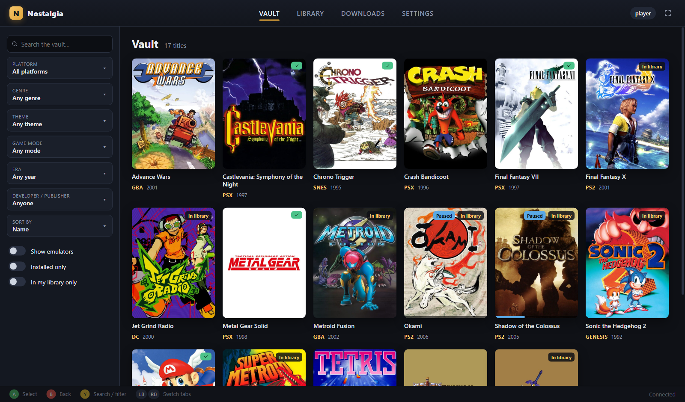
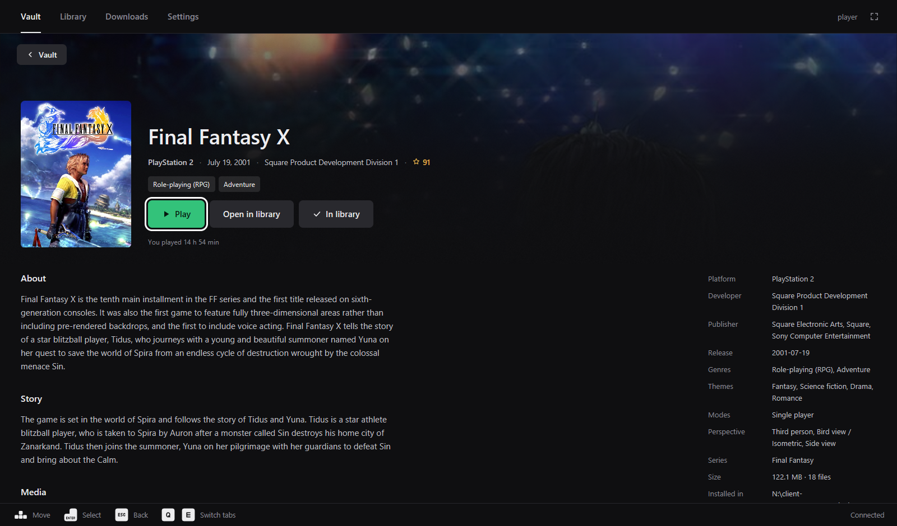
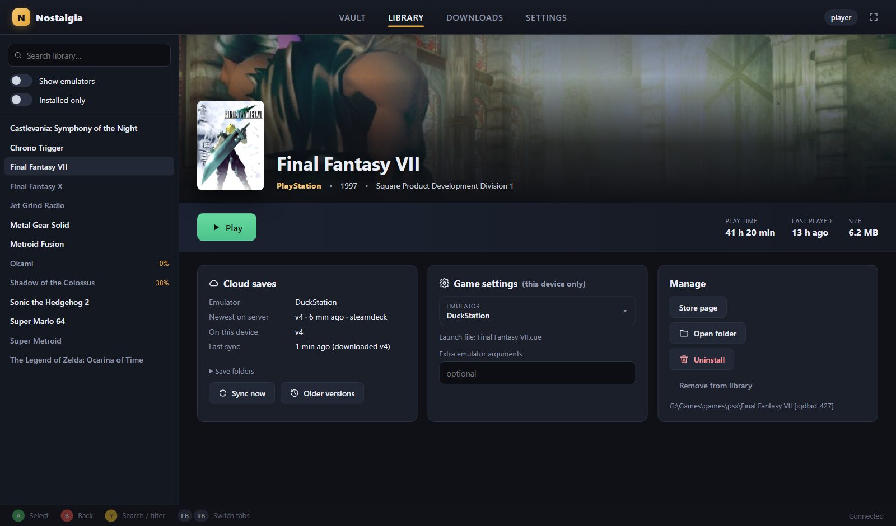
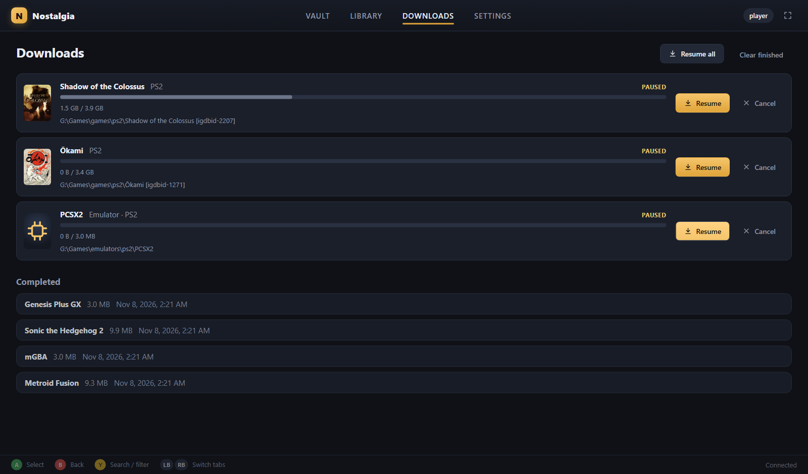
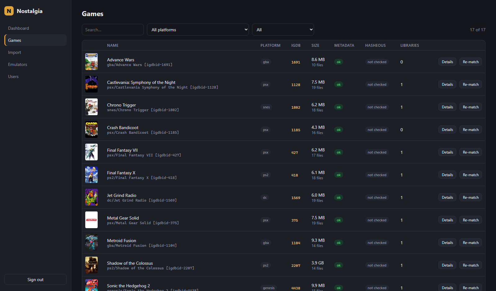
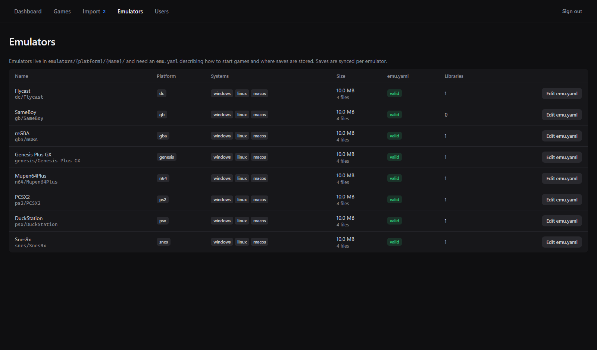

# Nostalgia

> [!WARNING]
> **This project is completely vibe-coded.**
> Every line of code, the configuration and this documentation was written by an AI
> (Claude) from a short plan, without a human reviewing the code. It has been tested
> against a small local library, but not audited or used in production. Expect bugs,
> keep backups of your games and saves, and don't expose the server to the internet
> without putting your own security in front of it. Use at your own risk.

Self-hosted retro game library: a **server** that holds your games, emulators, users and
versioned cloud saves, and a **launcher client** (Windows + SteamOS/Linux) that looks and
feels like a modern game store. It can be used with mouse, keyboard or a game controller.



| Store page | Library |
| --- | --- |
| [](docs/screenshots/store.png) | [](docs/screenshots/library.png) |
| **Downloads** (resumable, pausable) | **Admin UI**: games |
| [](docs/screenshots/downloads.png) | [](docs/screenshots/admin-games.png) |

```
┌──────────────────────────── server (Node.js) ─────────────────────────────┐
│ library/games/{platform}/{Name} [igdbid-ID]/…   IGDB metadata + artwork    │
│ library/emulators/{platform}/{Emulator}/emu.yaml Hasheous hash check       │
│ database/nostalgia.db (users, libraries, play time) Admin web UI /admin    │
│ saves/{user}/{emulator}/vNNNNN-….zip  (versioned, never deleted)           │
└──────────────┬────────────────────────────────────────────────────────────┘
               │ REST + Server-Sent-Events (push of new cloud saves)
┌──────────────┴──────────── client (Electron) ─────────────────────────────┐
│ Vault · Library · Downloads · Settings   gamepad / keyboard / mouse        │
│ resumable downloads · emulator launch · play time · save sync · offline    │
└────────────────────────────────────────────────────────────────────────────┘
```

**Why TypeScript / Node.js / Electron?** One language for server, client and the shared
protocol types. Node runs anywhere and has SQLite built in, so the server needs no native
modules. Electron ships one Chromium for both Windows and SteamOS, with a reliable Gamepad API
for controller navigation, and packages as an `.exe` installer or as an AppImage. The AppImage
runs on SteamOS's read-only system without installing anything.

---

## Server

### Run

**Prebuilt package** (from the *Server build* workflow, see [Builds](#builds)): unpack
`nostalgia-server-x.y.z-windows-x64.zip` or `nostalgia-server-x.y.z-linux-x64.tar.gz` and run
`start.cmd` / `./start.sh`. Node.js is included; nothing else needs to be installed.

**From source:**

```bash
npm install
npm run build -w server
node server/dist/server.js --settings /path/to/settings.yaml
# or during development
npm run server:dev            # uses ./server/settings.yaml
```

When the settings file is missing, a template is written on first start. Then open
`http://<server>:8080/admin`.

### Docker

Image: `ghcr.io/neiloru/nostalgia-server` (`linux/amd64` and `linux/arm64`, published by the
*Docker image* workflow). Use [`server/docker-compose.example.yml`](server/docker-compose.example.yml):

```bash
mkdir nostalgia && cd nostalgia
curl -o docker-compose.yml https://raw.githubusercontent.com/neiloru/Nostalgia/main/server/docker-compose.example.yml
# set the library path in docker-compose.yml, then:
docker compose up -d
# edit ./config/settings.yaml (created on first start, at least adminPassword), then:
docker compose restart
```

| volume | content |
| --- | --- |
| `/config` | `settings.yaml` |
| `/library` | `games/{platform}/…` and `emulators/{platform}/…` |
| `/database` | SQLite database. Keep it on a local disk. **Back this up.** |
| `/saves` | versioned cloud saves. **Back this up.** |

The paths of library, database and saves are fixed by the image (`NOSTALGIA_LIBRARY`,
`NOSTALGIA_DATABASE`, `NOSTALGIA_SAVES`); settings.yaml cannot move them inside the container.
To keep the saves somewhere else, mount that folder at `/saves`. Update with
`docker compose pull && docker compose up -d`. To build the image yourself from a clone, run
`docker build -f server/Dockerfile -t nostalgia-server .` in the repository root.

### Settings (`settings.yaml`)

| key | meaning |
| --- | --- |
| `adminUsername` / `adminPassword` | login for the admin web UI |
| `libraryDirectory` | root of the game library (relative paths are relative to the settings file) |
| `igdbClientId` / `igdbClientSecret` | Twitch/IGDB API credentials ([how to get them](https://api-docs.igdb.com/#account-creation)) |
| `port`, `host` | listen address (default `0.0.0.0:8080`) |
| `databaseDirectory` | SQLite database (default `./database`). Keep it on a local disk. **Back it up.** |
| `savesDirectory` | versioned cloud saves (default `./saves`), any folder or mounted drive. **Back it up.** |
| `allowRegistration` | allow users to register from the client (default `true`) |
| `scanIntervalMinutes` | automatic rescans (default 30, `0` = off) |
| `hasheousOnScheduledScan` | also hash files during automatic scans (default `false`) |

Environment overrides: `NOSTALGIA_SETTINGS`, `NOSTALGIA_PORT`, `NOSTALGIA_LIBRARY`,
`NOSTALGIA_DATABASE`, `NOSTALGIA_SAVES`, `IGDB_CLIENT_ID`, `IGDB_CLIENT_SECRET`.

### Library layout

```
library/
  games/
    psx/
      Final Fantasy VIII [igdbid-425]/
        Final Fantasy VIII (USA) (Disc 1).cue
        Final Fantasy VIII (USA) (Disc 1).bin
        …                                   all files are sent to the client
        igdb/                               written by the server
          metadata.json  igdb-raw.json  cover.jpg  artwork-01.jpg  screenshot-01.jpg …
    ps2/
      Final Fantasy X [igdbid-418]/Final Fantasy X (USA, Canada).iso
  emulators/
    ps2/
      PCSX2/
        emu.yaml
        pcsx2-qt.exe  pcsx2.AppImage  …
```

* Platform folders use the [RomM folder names](https://docs.romm.app/latest/platforms/supported-platforms/)
  (`psx`, `ps2`, `snes`, `gba`, `n64`, `genesis`, `dc`, …). The common ones are created
  automatically.
* **The server never deletes files.** Missing games are only marked as missing.
* Multi-disc games and cue/bin sets are simply all files of the game folder.
* Every game folder needs an IGDB id. Files dropped directly into `games/{platform}/` (or
  folders without the tag) are listed in **Admin → Import**. There you select the files of
  one game, optionally let **Hasheous identify** them by hash (it usually returns the IGDB id),
  pick the IGDB entry and the files are *moved* into `{Name} [igdbid-ID]/`.
* On every scan, new games get their IGDB metadata, cover, artworks and screenshots
  downloaded in the background into the game's `igdb/` folder.
* The optional Hasheous check (checkbox on the dashboard or per game) hashes every file
  (MD5/SHA1/CRC32) and looks it up at hasheous.org. This is information for the admin only.

### emu.yaml

```yaml
name: PCSX2
description: PlayStation 2 emulator
# Launchable extensions in priority order. All files of the first matching extension
# become selectable discs (cue wins over bin, m3u over cue, …).
extensions: [m3u, chd, iso, cso, cue, bin]
systems:
  windows:
    executable: pcsx2-qt.exe                 # relative to the emulator folder
    arguments: -nogui -fullscreen "{rom}"    # string or list
    saves:                                   # folders synced as cloud save
      - "{documents}/PCSX2/memcards"
  linux:
    executable: pcsx2.AppImage
    arguments: ["-nogui", "-fullscreen", "{rom}"]
    saves:
      - "~/.config/PCSX2/memcards"
    # optional: workingDirectory, env: { KEY: value }
```

Placeholders: `{rom}` (selected file/disc), `{romDir}`, `{gameDir}`, `{emulatorDir}`, `{home}`,
`{documents}`, `{appData}`, `{config}` (`$XDG_CONFIG_HOME`), `{dataHome}` (`$XDG_DATA_HOME`),
plus environment variables (`%USERPROFILE%`, `$HOME`, `${VAR}`) and `~`.
The old `saveFolder:` key (single folder) is accepted too. emu.yaml can be edited in the
admin UI (the previous version is kept in `database/emu-yaml-history`).



### Cloud saves

* Saves are stored **per user and per emulator**, because the save location belongs to the
  emulator (e.g. PCSX2 memory cards hold all PS2 games).
* Every upload is a new version (`saves/{user}/{emulator}/v00001-….zip`) in `savesDirectory`,
  separate from the database. Identical uploads are deduplicated. **Nothing is ever deleted.**
* On start (and in the admin dashboard) the server checks that the saves folder is writable and
  that the newest saves are there, and reports an error otherwise.
* Servers from before the split kept saves in `data/saves`. On the first start they are copied
  to `savesDirectory` and the old folder is renamed to `saves-moved-<date>` (not deleted); an old
  `dataDirectory` setting is read as `databaseDirectory`.
* Connected clients are notified through Server-Sent Events and pull new versions right away.

---

## Client

```bash
npm install
npm run client:dev                 # development (hot reload)
npm run dist:win  -w client        # Windows installer + portable exe  -> client/release
npm run dist:linux -w client       # AppImage + tar.gz (build on Linux)  -> client/release
npm run icons -w client            # re-render build/icon.{png,ico} from build/icon.svg
```

Prebuilt clients come from the *Client build* workflow, see [Builds](#builds).

### Steam Deck / SteamOS

1. Copy `Nostalgia-x.y.z-*.AppImage` to the Deck and make it executable.
2. Desktop mode → Steam → *Add a Non-Steam Game* → select the AppImage.
3. Start it from Game Mode. Inside gamescope Nostalgia starts in fullscreen automatically
   (otherwise use `--fullscreen` or Settings → Display).
4. Put Linux builds of the emulators (AppImages) in the emulator folders on the server and
   reference them in `systems.linux` of the emu.yaml.

Started from Steam (or inside gamescope), the Linux launcher turns off Chromium's sandbox, keeps
Steam's overlay library out of Electron (emulators still get it) and uses X11; otherwise Electron
crashes on startup there. Its output is written to `~/.config/Nostalgia/logs/launch.log`
(the run before: `launch.previous.log`). Set `NOSTALGIA_NO_SANDBOX=1` to turn the sandbox off
outside Steam as well.

### Features

* **Vault**: every game on the server, with filters for platform, genre, theme, game mode, era
  and developer/publisher, plus sorting. "Show emulators" (off by default), "Installed only" and
  "In my library only" checkboxes. Every game has a store page with artwork, description, story,
  screenshots and facts from IGDB.
* **Library**: your games (and optionally emulators). Play / install / uninstall, play time,
  cloud save status and older versions, and per-game settings stored only on this device
  (emulator, disc for multi-disc games, extra arguments).
  Adding a game adds the emulators of its platform automatically, and installing a game also
  installs its emulator (can be switched off).
* **Downloads**: resumable downloads (HTTP range) that can be paused, survive restarts, and
  show speed and remaining time.
* **Settings**: change password, log out, add/remove download locations, sync and display
  options.
* **Playing**: the game starts in the emulator from emu.yaml. Play time is tracked and uploaded.
  If the launcher crashes mid-session, the play time is recovered from a heartbeat file.
* **Cloud saves**: on start, right after an emulator is installed, and before every launch, the
  newest version of every installed emulator is downloaded (also when the local save folder
  went missing, e.g. after reinstalling the emulator). After the emulator closes, changed saves are uploaded; failed uploads
  are retried. Local saves that were never uploaded are copied to a backup folder before they
  are replaced. Restoring an older version uploads it again as the newest version.
* **Offline**: the catalog, details and artwork are cached. Without a connection, games that are
  not installed are greyed out and an offline notice is shown. Installed games keep their
  covers, artwork and store pages and can be played. Play time and saves are uploaded when the
  server is reachable again.

### Launch parameters

| parameter | effect |
| --- | --- |
| `--fullscreen` | start in fullscreen |
| `--windowed` | start in a window (overrides the "Start in fullscreen" setting) |
| *(none)* | uses Settings → Display → *Start in fullscreen* (on by default inside Steam Deck Game Mode / gamescope) |

F11 toggles fullscreen at any time. Example for Steam: set the launch options of the
non-Steam shortcut to `--fullscreen`.

### Controls

| action | controller | keyboard |
| --- | --- | --- |
| move | D-pad / left stick | arrow keys |
| select | A | Enter |
| back | B | Esc / Backspace |
| switch tabs | LB / RB | Q / E, PageUp / PageDown |
| search / filter | Y | F or `/` |
| settings | Start | |
| fullscreen | | F11 |

### Client data

Everything is stored in the Electron user data folder (`%APPDATA%/Nostalgia`,
`~/.config/Nostalgia`). Put a file called `portable` next to the executable, or set
`NOSTALGIA_DATA_DIR`, to keep it elsewhere. Save backups live in `save-backups/`.

---

## Development

```
shared/   protocol types, RomM platform list, emu.yaml parsing, launch helpers
server/   Express server, SQLite (node:sqlite), IGDB, Hasheous, admin UI (server/admin)
client/   Electron main process (src/main), preload, React renderer (src/renderer)
examples/ example emu.yaml files
```

```bash
npm run typecheck
npm test            # server + shared tests (node:test)
npm run package -w server   # self-contained server package for this OS -> server/release
```

### Builds

Every push to `main` runs [Build and pre-release](.github/workflows/prerelease.yml): typecheck
and tests, client and server for Windows and SteamOS/Linux, then a GitHub **pre-release**
`v<version>-pre.<run>` with all files and the commits since the previous pre-release (see
[Releases](https://github.com/neiloru/Nostalgia/releases)). The Docker image is built and pushed on
every push as well. Each workflow can also be started by hand (*Actions* → workflow → *Run
workflow*, with `all`, `windows` or `linux` and optionally without tests); the files are then
attached to the run as artifacts only.

| workflow | Windows | SteamOS / Linux |
| --- | --- | --- |
| [Client build](.github/workflows/client.yml) | `Nostalgia-x.y.z-x64-setup.exe` (installer), `Nostalgia-x.y.z-x64-portable.exe` | `Nostalgia-x.y.z-*.AppImage`, `Nostalgia-x.y.z-*.tar.gz` |
| [Server build](.github/workflows/server.yml) | `nostalgia-server-x.y.z-windows-x64.zip` | `nostalgia-server-x.y.z-linux-x64.tar.gz` |
| [Docker image](.github/workflows/docker.yml) | | `ghcr.io/neiloru/nostalgia-server` (`latest`, `sha-…`, optional extra tag) |

Server packages contain the bundled server, the admin UI, a Node.js runtime, a start script
and `settings.example.yaml`. The Linux server package is started and checked in CI before it
is uploaded. The Docker workflow starts the container and waits for its healthcheck before it
pushes. After the first push, set the package to *Public* (GitHub → profile → *Packages* →
nostalgia-server → *Package settings*) so `docker pull` works without logging in.

---

## License

[MIT](LICENSE). Game metadata and artwork come from [IGDB](https://www.igdb.com) and are subject
to their terms; hash lookups use [Hasheous](https://hasheous.org). No games, BIOS files or
emulators are included in this repository.
